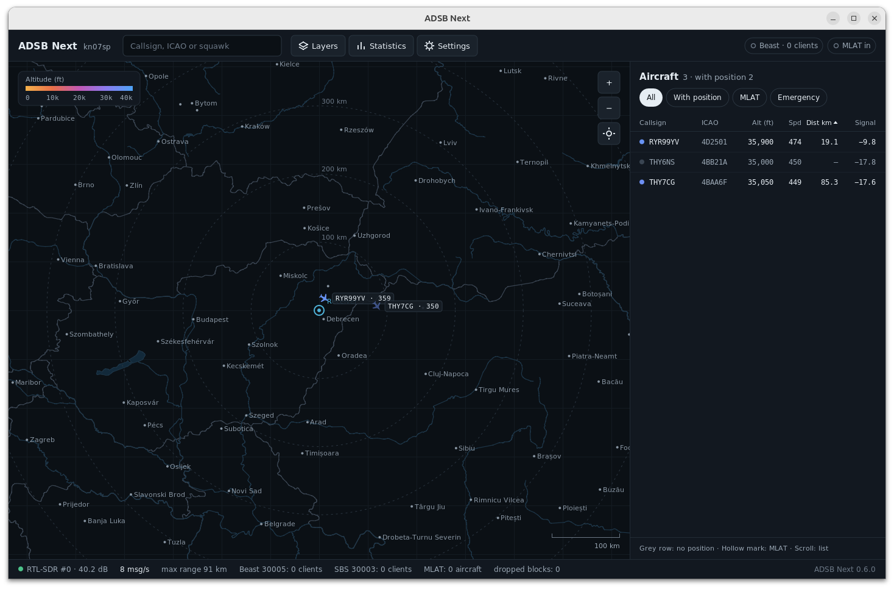

# ADSB Next — Mode S / ADS-B decoder

English · **[Magyar](README.hu.md)**

HG0MV · 0.4.0

A 1090 MHz Mode S / ADS-B decoder for RTL-SDR, written from scratch in C.
It works as a feeder: PiAware (FlightAware), fr24feed and other clients
connect to it exactly as they would to dump1090-fa. It also has its own
native desktop interface (map, aircraft list, details, statistics) that
needs no web browser.

> The user interface is currently in Hungarian. An English version is
> planned for the next release.

## Highlights

- **Own demodulator.** 2.4 MS/s upsampled to 12 MHz; timing is estimated
  from the whole message, not only the preamble; bits are decided at the
  half-bit centres; 1-bit error correction plus soft-decision 2–3-bit
  correction on the least confident bits.
- **Phantom aircraft protection.**
  - A new aircraft can only come from an error-free message.
  - Corrected messages, DF11 with a non-zero IID and address/parity
    messages (DF0/4/5/16/20/21) are only accepted for known addresses.
  - An aircraft counts as real after two confirmed messages.
  - Positions are checked against range and speed.
- **Positions from a single message** when reception is weak (see below),
  with protection against the CPR zone "mirror" trap.
- **Feeder ready.** Beast output with 12 MHz timestamps (MLAT capable),
  SBS/BaseStation and raw output, Beast input for MLAT results.
- **Native GUI.** Anti-aliased software rendering (`src/gfx.c`) with
  FreeType text, offline vector base map from Natural Earth.
- **Gain assistant** that measures each gain step and recommends the one
  with the most positions without overload.

## Building and installing (Ubuntu)

    sudo apt install build-essential librtlsdr-dev \
                     libx11-dev libfreetype-dev libfontconfig-dev curl
    make
    make map             # download and convert the base map (once, ~30 MB download)
    make test            # automated tests (~2 minutes)
    sudo make install    # /usr/local/bin, map, systemd service

The Makefile detects librtlsdr and the GUI libraries (X11, FreeType,
fontconfig) on its own. If one is missing, that part is left out and the
rest still works.

## Graphical interface

    ./adsbnext --gui --locator KN07sp --callsign HG0MV

- **Map.** Drag with the left button to pan, scroll to zoom around the
  cursor (`+`/`-` keys, `c` = centre on the receiver). Aircraft point in
  their direction of flight and are coloured by altitude (amber = low,
  blue = high). Aircraft with an MLAT position get a hollow icon.
- **Selection.** Click an aircraft or a list row. The details card shows
  altitude, vertical rate, speed, track, distance and bearing from your
  QTH, squawk and an altitude profile. Emergency squawks
  (7500/7600/7700) are shown in red. Esc or a click on empty map clears
  the selection.
- **List.** Click a column header to sort (click again to reverse),
  scroll to page through. Filters: all / with position / MLAT /
  emergency. The search box accepts callsign, ICAO address or squawk.
- **Layers menu.** Base map, city names, coverage (measured maximum
  distance per 5° sector), trails of all aircraft, range rings.
- **Status bar.** Source and gain, messages/s, maximum range, network
  clients, MLAT aircraft, dropped sample blocks.
- **IQ recording playback.** With a file (`-f recording.iq --gui`)
  playback runs in real time and the window stays open at the end.

### Statistics (toolbar: Statistics, Esc: back)

- **Since start:** aircraft seen, maximum distance (with callsign and
  bearing), average message rate, aircraft seen with MLAT.
- **Coverage by bearing:** since start (filled) and all-time (dashed,
  saved).
- **Last 24 hours:** messages/s and average number of aircraft, per hour.
- **Message types:** share of each type, share of corrected messages and,
  within that, of soft-decision corrections.
- **Reception and clients:** source, gain, signal level and overload,
  network clients, dropped blocks.

Coverage and hourly data are saved to `~/.local/share/adsbnext/stats.txt`
every 5 minutes and on exit.

### Settings

- **Receiver:**
  - gain slider using the tuner's real gain steps;
  - tuner AGC;
  - ppm correction;
  - soft-decision correction on/off;
  - single-message positions on/off;
  - live signal level and overload.
- **Gain assistant** (live reception only):
  - **What it measures:** for each of 9 steps it waits 3 s to settle,
    then measures messages/s, positions/min and overload for 15 s.
  - **What it recommends:** the step with the most positions without
    overload (0.5% clipped samples). Within 3% of the best, the step with
    more messages wins.
  - **After the run:** the recommendation is applied right away and saved
    with OK. Feeders keep receiving data during the measurement.
- **Location:** callsign, QTH locator (the coordinates are shown as you
  type), maximum range.
- **Network:** bind address and ports, with the number of clients.
- **Feeders:** how to set up PiAware, FR24 and VRS, with the current
  connections.

Gain, ppm, callsign, range and the decoding switches take effect
immediately. Locator, network and device changes take effect after a
restart.

## Configuration file

`~/.config/adsbnext/adsbnext.conf`. The Settings window writes it, but it
can also be edited by hand:

    callsign = HG0MV
    locator = KN07sp
    gain = 40.2          # or: auto
    ppm = 0
    max_range = 500
    rx_relative = 1
    soft_fix = 1
    net_bind = 0.0.0.0
    net_bo_port = 30005

Precedence: defaults < configuration file < command-line options.
`--config FILE` uses another file, `--no-config` ignores it. The systemd
service runs under `DynamicUser` and does not see your personal
configuration file; there the options in `/etc/default/adsbnext` apply.

## Weak reception: positions from a single message

Normally a position needs an even and an odd CPR message within 10 s.
With weak reception (for example an indoor antenna) such pairs are rare.
If your QTH is known, ADSB Next can also decode a single message relative
to the receiver, when the result is unambiguous. Two safeguards apply:

- **Ambiguity check.** Every other possible solution in the neighbouring
  CPR zones must lie outside the range that is actually possible. That
  range is learned from positions decoded from pairs (which are
  unambiguous), plus 15%. Until at least 50 such positions exist, the full
  configured maximum range (default 500 km) is used, which is the most
  cautious choice at start-up.
- **Confirmation.** The first such position is only a candidate. It is
  accepted when a following message lands at a place consistent with the
  aircraft's speed.

Test result:
- **150 km:** a position is decoded from three messages of the same
  parity, accurate to a few metres.
- **420 and 440 km:** no position is produced, because of the mirror trap.

Switch it off with `--no-rx-relative` or in Settings.

## Base map

`make map` downloads Natural Earth 1:10m data (public domain): borders,
coastline, rivers, lakes and populated places. It crops them to a box
around the Carpathian Basin and converts them to `map/adsbnext.map` (a few
hundred KB). For another area use
`make map MAP_BBOX=west,south,east,north`, for example
`make map MAP_BBOX=5,38,38,57`.

If the download fails, put the GeoJSON files from naturalearthdata.com
into `map/src/` with the same names and run `make map` again. The program
also runs without a map, then only the grid and range rings are shown.

Fonts: Inter and JetBrains Mono if installed, otherwise DejaVu Sans and
DejaVu Sans Mono.

## Network ports

| Port | Direction | Format | Used by |
|---|---|---|---|
| 30005 | out | Beast (12 MHz timestamps) | PiAware, fr24feed, mlat-client, ADSB.lol etc. |
| 30003 | out | SBS / BaseStation text | Virtual Radar Server, PlanePlotter |
| 30002 | out | `*HEX;` lines | debugging, older programs |
| 30104 | in | Beast | MLAT results (sent back by PiAware) |

With live reception the network is on by default. With a file, `--net`
turns it on and the file plays back in real time. Ports are set with
`--net-bo-port`, `--net-sbs-port`, `--net-ro-port`, `--net-bi-port`
(0 = off) and the bind address with `--net-bind` (default: all
interfaces).

MLAT results go into the aircraft table and the SBS output, but on
purpose not into the Beast output; otherwise PiAware would receive its
own MLAT data back. Data from the network is never corrected, only
accepted with a valid CRC.

## Using it as a feeder

### 1. Replace dump1090-fa

The two cannot run at the same time, because they use the same dongle
and the same ports:

    sudo systemctl disable --now dump1090-fa

### 2. Run ADSB Next as a service

    sudo nano /etc/default/adsbnext      # locator, gain
    sudo systemctl enable --now adsbnext
    journalctl -u adsbnext -f            # log, status line every 5 minutes

If the log says the device cannot be opened, remove the
`DynamicUser=yes` line from `/etc/systemd/system/adsbnext.service` and
run `sudo systemctl daemon-reload && sudo systemctl restart adsbnext`.

### 3. PiAware (FlightAware)

Tell PiAware to connect to an external decoder on port 30005 instead of
looking for its own:

    sudo piaware-config receiver-type other
    sudo piaware-config receiver-host localhost
    sudo piaware-config receiver-port 30005
    sudo systemctl restart piaware

The `relay` type only works on the FlightAware SD card image; for a
package install `other` is the right one. The MLAT client
(fa-mlat-client) reads from 30005 and by default sends its results to
`localhost:30104`. ADSB Next accepts them and marks such aircraft with M
in the summary. For MLAT, the exact station location must also be set on
the FlightAware website.

Check with `sudo piaware-status`: it should report that a program is
listening on port 30005 and that PiAware is connected to it.

### 4. FR24 (optional)

In `/etc/fr24feed.ini`:

    receiver="beast-tcp"
    host="127.0.0.1:30005"

### 5. Virtual Radar Server / PlanePlotter

Add a receiver in the program: BaseStation (SBS) format, the IP address
of the ADSB Next machine, port 30003. Or Beast format on port 30005.

## Tips for the FlightAware Pro Stick (orange)

- **Gain.** The Pro Stick has a built-in LNA, so the default is 40 dB
  rather than the maximum. If you see many corrected messages but few
  aircraft, try lower (`--gain 33.8`) or run the gain assistant.
- **Filter.** The orange stick has no built-in filter. Put the
  FlightAware 1090 MHz filter in front of it.
- **Antenna.** This matters most. A small indoor antenna sees a few tens
  of kilometres. A quarter-wave ground plane (about 69 mm vertical
  element, four 69 mm radials bent down at 45°), mounted high and
  outdoors, is far better.

## IQ recording and comparison

    ./adsbnext --record recording.iq --seconds 60
    ./adsbnext -f recording.iq --locator KN07sp
    python3 tools/iq_stats.py recording.iq     # overload and signal level per second
    tests/compare.sh recording.iq              # compare with dump1090-fa / readsb output

## Options

`adsbnext -h` lists all of them. The most important ones:

| Option | Meaning |
|---|---|
| `-f FILE` | decode an IQ file (`-` = stdin) |
| `--record FILE` | save raw IQ |
| `--seconds N` | length of reception |
| `--gain DB\|auto` | gain (default 40) |
| `--ppm N` | frequency correction |
| `--locator LOC` | your QTH (position checks, distances) |
| `--callsign CALL` | your callsign on the map |
| `--gui` | graphical interface |
| `--map FILE` | map file |
| `--net` / `--no-net` | network on/off |
| `--config FILE` / `--no-config` | configuration file |
| `--no-rx-relative` | positions only from even+odd pairs |
| `--no-soft-fix` | disable soft-decision (2–3 bit) correction |
| `--throttle` / `--no-throttle` | play a file in real time or as fast as possible |
| `--stats N` | status line every N seconds |
| `--raw`, `--quiet` | output mode |

## How it works

- **Threads.** Reception runs on its own thread and writes into a
  32-block queue. Demodulation and networking run on the main thread, so
  a slow client cannot cause USB sample loss. If the machine still cannot
  keep up, the summary reports how many blocks were dropped.
- **Slow clients.** Each client has its own 512 KB buffer. If it fills
  up, that client is disconnected; the others are not affected.
- **Demodulator.** 12 MHz upsampling, whole-message timing, half-bit
  centre decisions, 1–3-bit (soft) error correction.
- **Phantom protection.** See Highlights.

## Test results (`make test`)

The tests use a synthetic IQ generator (`tools/gen_iq`) with noise,
frequency offset and random timing.

- **Reference messages:** all decoded correctly.
- **Sensitivity:** about 85% of messages at 11 dB SNR, about 99% at
  13.5 dB.
- **False alarms:** none from pure noise.
- **7-aircraft scenario** (15–420 km, including weak signals): at most
  4 m position error, no phantom aircraft and no wrong position.
- **Sparse messages of one parity:** a position from a single message at
  150 km; none at 420/440 km, where it would be ambiguous.
- **MLAT timestamps:** 26 ns standard deviation against the true
  transmission times. This is the limit of the Beast format's 12 MHz
  resolution (24 ns); it cannot get better.
- **Gain assistant with a simulated receiver:** picks and sets the
  correct step in all three scenarios.
- **Network:**
  - all 765 frames match on the Beast and raw outputs;
  - 303 SBS position lines;
  - MLAT input: 2 accepted, 1 corrupted rejected, nothing echoed back to
    the Beast output.
- **GUI under Xvfb:** starts and shuts down cleanly on SIGTERM. Decoding
  and drawing together use about 21% of one CPU core.
- **Load:** at 6,500 messages/s a client connected from the start
  received 119,999 of 119,999 frames; a client that did not read was
  disconnected.

## Limitations

- **Not yet available:**
  - English user interface (planned for the next release);
  - aircraft log to file;
  - Windows version.
- **Gain control:** the gain assistant and live gain changes have not been
  tested with a real dongle yet. The logic runs in a simulation test.
- **PiAware:** not yet tested with a real PiAware. The protocol (Beast,
  12 MHz timestamps, escaping) is covered by tests, but watch the
  `piaware-status` output the first time you connect.

## Files

    src/main.c      main loop, command line, summary
    src/gui.c       interface: map, list, details, statistics, settings (platform independent)
    src/gui_x11.c   X11 window and events
    src/gfx.c       anti-aliased drawing, FreeType text
    src/mapdata.c   map file, projection
    src/config.c    configuration file
    src/source.c    reception thread (RTL / file), sample queue
    src/net.c       TCP servers, Beast input parser
    src/sbs.c       SBS format
    src/demod.c     demodulator
    src/decode.c    message validation and fields
    src/cpr.c       CPR positions
    src/aircraft.c  aircraft table, plausibility checks
    src/beast.c     Beast encoding
    src/crc.c       CRC, error correction
    src/rtlcap.c    RTL-SDR handling
    src/locator.c   Maidenhead locator, distances
    dist/           systemd service and defaults file
    tools/          gen_iq (test signals), iq_stats.py (recording analysis),
                    ne_convert.py (Natural Earth -> map file)
    tests/          tests
    docs/           screenshots

## Acknowledgements

- Base map data: [Natural Earth](https://www.naturalearthdata.com/)
  (public domain).
- Reference messages and background:
  [The 1090 Megahertz Riddle](https://mode-s.org/decode/) by Junzi Sun.
